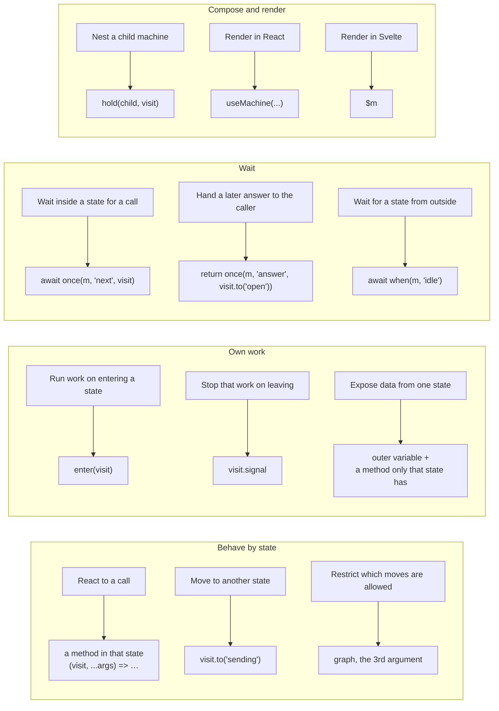
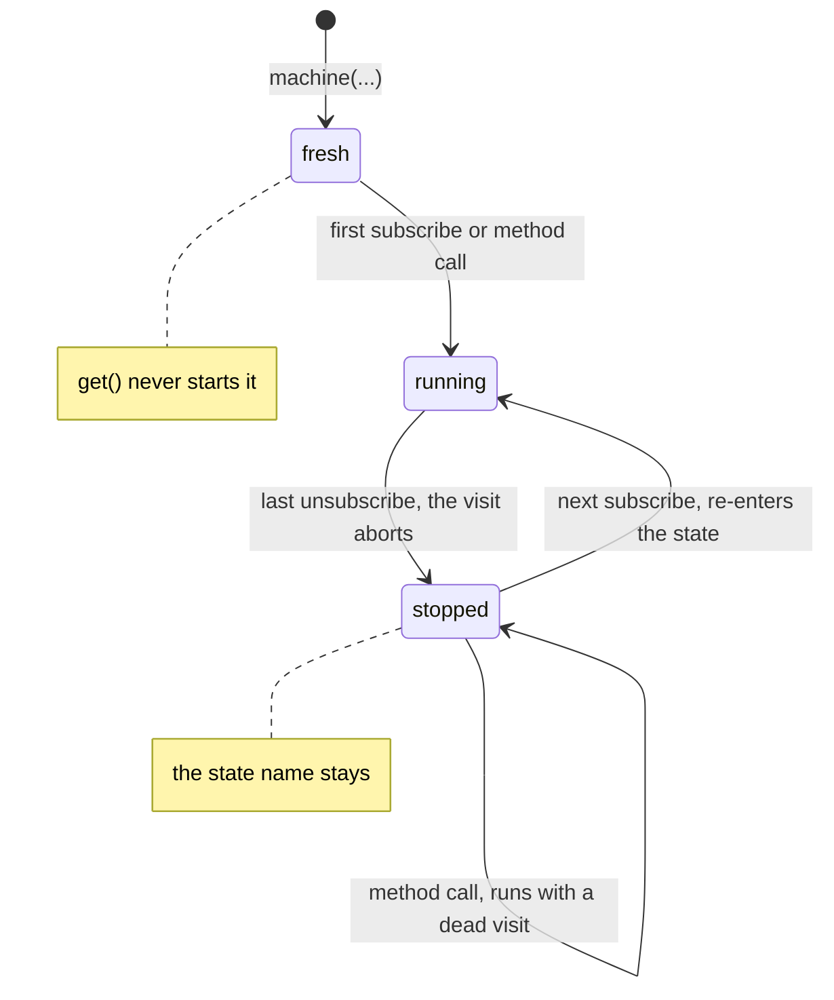
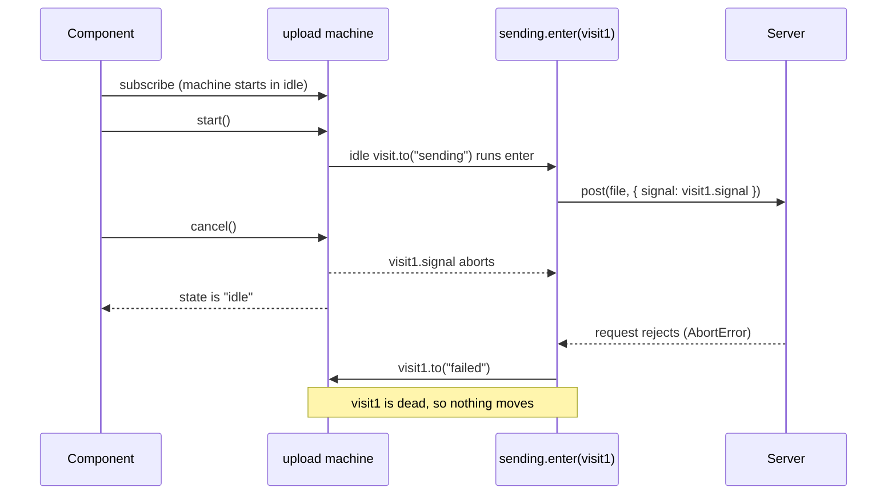
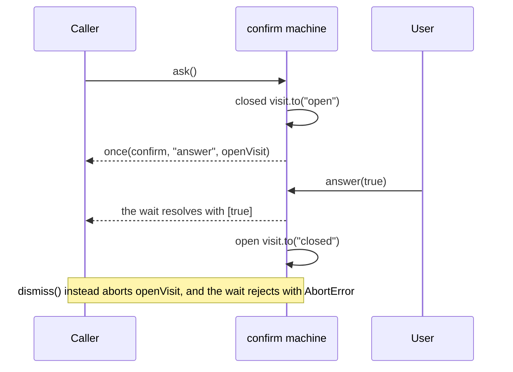

# @muxmuxmux/machine: design, iteration 4

A separate package beside `@muxmuxmux/core`. Iteration 4 folds in the probe of the four open questions. The package lives in [packages/machine](../packages/machine/README.md). The prototype and its tests live in [machine-prototype/](machine-prototype/README.md), rebuilt from the session transcripts. It stays as the evidence behind the decisions below, including the mutants and the rejected API shapes.

## API

```ts
import { hold, machine, once, when } from "@muxmuxmux/machine";

const upload = machine("idle", {
	idle: { start: (visit) => visit.to("sending") },
	sending: {
		enter: async (visit) => {
			try {
				await post(file, { signal: visit.signal });
				visit.to("idle");
			} catch {
				visit.to("failed");
			}
		},
		cancel: (visit) => visit.to("idle"),
	},
	failed: { retry: (visit) => visit.to("sending") },
});
```

| Export                             | What it is |
| ---------------------------------- | ---------- |
| `machine(initial, states, graph?)` | Creates a machine: a store of the state name plus one method per name any state declares |
| `once(m, method, { signal })`      | Resolves with the arguments of the next call to `method`; rejects with the signal's reason |
| `when(m, state, { signal })`       | Resolves once the machine is in `state`; works on any `{ get, subscribe }` |
| `hold(child, visit)`               | Keeps `child` running for exactly as long as `visit` lasts |
| `Visit`, `Graph`, `Machine`        | Types |

A fuller example, the repo's submit button as a machine, runs in [machine-prototype/example.ts](machine-prototype/example.ts).

The `@muxmuxmux/machine/react` subpath exports `useMachine(initial, states, graph?)`. React is an optional peer dependency of `@muxmuxmux/machine`, so users without React install nothing extra.

## Core or machine

Core is enough when each state only picks which handler runs, and every move happens at once. Use the machine when a state owns async work or a timer that must stop when the state ends.

|                             | Core `controller`                      | Machine `machine` |
| --------------------------- | -------------------------------------- | ----------------- |
| How moves happen            | `ctrl.set(state)`, from anywhere       | `visit.to(state)`, from inside a method or `enter` |
| Work owned by a state       | none                                   | `enter(visit)` runs on every entry |
| Cancelling                  | up to you                              | `visit.signal` aborts when the state ends |
| A late result               | still moves the state                  | does nothing, because its visit has ended |
| Lifecycle                   | none; always live                      | starts on first use, stops on the last unsubscribe |
| A move to the current state | does nothing (`Object.is`)             | re-enters: aborts the visit and runs `enter` again |
| Waiting                     | none                                   | `once(m, method)`, `when(m, state)` |
| Allowed moves               | any                                    | an optional graph, checked by types and at runtime |
| Svelte                      | a writable store, so `$ctrl = …` works | a readable store; `get(m)` and server render run `enter` |

Stay on core when:

- handlers only switch state: tabs, a menu, view or edit mode, wizard steps;
- outside code sets the state, for example from the URL or a server push;
- nothing should depend on subscribers.

Use the machine when:

- a handler would `await` and then call `set`, as `handleSubmit` does in `examples/react-button`;
- a handler would start a timer;
- a cancel must win over a late result;
- a flow waits on the user, as with `once` or `when`;
- a child flow lives exactly as long as a parent state, as with `hold`.

Quick test: if every handler calls `set` before any `await` and starts no timer, stay on core.

`when` accepts any `{ get, subscribe }`, so a machine can wait on a core controller.

### In the skills

The skills will carry this guide, so an agent picks the right package. The full guide lives in one skill only.

- The machine's skill carries the full guide, pointing back to core for the cases core covers.
- Core's skill carries only the quick test and points to the machine's skill. It needs that much, because the version-matched ways to load a skill read only installed packages: the `node_modules` path and `npx @tanstack/intent install`. So an agent with only core installed never sees the machine's skill.
- Add the quick test to core's skill only once the machine is on npm. Before that, the shipped skill would point at a package npm does not have.

## Rules

### Methods and visits

- A **visit** is one stay in a state. It ends when the machine leaves, even if it comes back later.
- Every method gets the current visit first. The public method drops it, so `upload.start(e)` takes the event first.
- A method that returns a visit reads as `void` in its public type. Inside methods, `visit.to` still returns the target's visit.
- A call to a method the current state lacks does nothing and starts nothing.
- `visit.to(target)` moves only while the visit is current. Otherwise it does nothing and returns a dead visit.
- `visit.signal` aborts when the visit ends. `visit.active` says whether it is current.

### Entry

- `enter(visit)` runs on every entry into its state, whichever method moved there.
- Order: the old visit aborts, the new visit becomes current, `enter` runs, then subscribers hear the new state.
- A move inside `enter` is allowed. Subscribers hear only where the machine settles.
- If an async `enter` rejects with its own visit's abort reason, the machine stays silent. Any other error is rethrown.
- Locals in an async `enter` are data for that one visit.

### Lifecycle

The machine follows Svelte's `readable` store: it does work only while someone uses it.

| Phase   | Enters by                                                 | A method call |
| ------- | --------------------------------------------------------- | ------------- |
| fresh   | creation                                                  | starts the machine, then runs |
| running | first subscriber or call; a later subscriber after a stop | runs with the current visit |
| stopped | the last subscriber leaving; the current visit aborts     | runs with a dead visit, so nothing moves |

- `get()` never starts the machine. `once` and `when` neither start it nor keep it running.
- The stop is synchronous. React StrictMode therefore aborts the first in-flight `enter` and reruns it in development.
- Work does not survive a stop. A machine stopped mid-upload uploads again on restart.
- Keep a module-level machine alive with `m.subscribe(() => {})`.

### Svelte

The machine works in Svelte with no adapter, like a core controller. On Svelte 5.57.3:

- `$m` in a component subscribes on mount and unsubscribes on unmount. Mounting runs the initial `enter`, a move re-renders, and unmounting aborts the visit.
- `derived(m, …)` starts the machine on its first subscriber and stops it on the last.
- The machine is a readable store. Unlike a core controller, it has no `set`, so `$m = …` fails. Moves go through visits.
- `get(m)` from `svelte/store` subscribes and unsubscribes at once, so it runs `enter` and aborts it. Call `m.get()` instead.
- `fromStore(m).current` does the same on every read outside an effect.
- Server render subscribes for the length of the render. So the initial state's `enter` runs on the server and aborts when the render ends. React's server render reads `m.get` and never subscribes.

### Waiting

- Inside a state: `const [name] = await once(m, "setName", visit)`. Leaving the state rejects the wait, and `enter` ends quietly.
- For a caller: a method returns a wait, as in `ask: (visit): Promise<[ok: boolean]> => once(confirm, "answer", visit.to("open"))`. The return annotation breaks a type cycle.
- For a state: `await when(upload, "idle")`.
- Waiters resolve before the method body runs, so a method that leaves the state still resolves its waiter.
- A call that arrives before a flow waits for it is lost. Nothing is buffered.

### Graph

- Optional. With it, each state's `visit.to` accepts only that state's targets.
- The typecheck rejects an unlisted move, a target that is not a state, and a state with no row.
- The runtime checks the same rules for code that gets past the types. An unlisted move throws from `visit.to`, and a bad graph throws at creation.
- Inside an async `enter`, that throw is not the visit's abort reason, so it surfaces as an uncaught error. The machine stays where it was.
- Write it when someone reads the graph apart from the code: review, docs, path tests.

### Data

- Typed data on `visit.to(target, data)` is impossible: TypeScript fixes the methods object as `unknown` when a method's parameter type refers to it.
- Keep data in your own variable. A method only the data-bearing state defines exposes it, and reads as `T | undefined`.

### Same-state moves

- A move to the current state re-enters it: the old visit aborts and `enter` runs again. Subscribers stay quiet.
- Case: an idle timer that each `touch()` resets.

## Composition

- **Nested.** The parent's visit holds the child: `hold(track, visit)` inside the parent's `enter`. The child enters with the parent and stops when the parent leaves.
- **Child moves parent.** `await when(child, "done", visit); visit.to("next")`.
- **Parallel.** Two machines side by side, combined at render.
- **History.** It depends on where you create the child. A child created outside the parent's visit keeps its state across exits. One created inside `enter` restarts at its initial state.

`hold` exists for one trap. After an `await`, the visit may already be over, so an abort listener added then never fires and the child leaks. `hold` checks `signal.aborted` first.

```ts
export function hold(child, visit) {
	const off = child.subscribe(() => {});
	if (visit.signal.aborted) off();
	else visit.signal.addEventListener("abort", off, { once: true });
}
```

## React

```ts
export function useMachine(initial, states, graph) {
	const latest = useRef(states);
	useInsertionEffect(() => {
		latest.current = states;
	});
	const m = useMemo(() => {
		const delegates = {};
		for (const state of Object.keys(states)) {
			Object.defineProperty(delegates, state, {
				enumerable: true,
				get: () => latest.current[state],
			});
		}
		const made = machine(initial, delegates, graph);
		// Package-private: a hook-made machine starts only when React subscribes
		startOnSubscribe(made);
		return made;
	}, []);
	useSyncExternalStore(m.subscribe, m.get, m.get);
	return m;
}
```

- `startOnSubscribe(m)` is private to `@muxmuxmux/machine`. It lives in the internal `src/machine.ts`, which both entries import, and the `exports` map publishes only `.` and `./react`. It fixes the start mode before anything uses the machine, so `machine` keeps one signature.
- The subpath must import the module the root entry uses, not bundle its own copy. `once` and `when` find a machine's internals in a module-level `WeakMap`, so a second copy would break them for hook-made machines.
- Without the start-on-subscribe option, on React 18, a getter method called during render starts both StrictMode machines, and the discarded one leaks a running visit.
- The option matters on React 19 too. Without it, a render-time getter starts the kept machine during render, so `enter` runs inside render. Keep it after React 18 support ends. The subpath accepts `react` `^18.0.0 || ^19.0.0`, the same range as `@muxmuxmux/react`.
- Methods read the latest render's props. A running async `enter` keeps the props from when it entered. To read fresh props inside `enter`, call a sibling method such as `m.url()`.
- StrictMode on React 18.3.1: each render pass builds its own machine. The discarded one never enters, and the kept one enters twice with the first visit aborted.
- StrictMode on React 19.3.1: the memo factory still runs twice, but both render passes use the kept machine. So without the option, a render-time getter starts only the kept machine. Nothing leaks, but `enter` runs during render.

## Decisions and their evidence

| Decision                                                | Evidence |
| ------------------------------------------------------- | -------- |
| Visit-first methods                                     | Shapes where the visit refers to the methods object collapse targets to `never` |
| Graph optional                                          | Without a graph, `visit.to("idel")` still fails to compile, and stale results stay safe |
| Svelte lifecycle                                        | Six call sequences; five mutants each fail one |
| Dead visit after stop                                   | A restart mutant fails the lifecycle and React tests; under restart, an orphaned child moves |
| Method lookup before start                              | A start-first mutant fails the lifecycle test, and on React 18 the React test too |
| Synchronous stop                                        | A deferred-stop mutant fails four test files |
| Public `void` for returned visits                       | Removing it fails three type assertions |
| Internal start-on-subscribe                             | React guard table: 2 enters and 0 leaks, and the first render reads the getter. Without it, React 18 leaks one visit and React 19 leaks none. In the package, `react.test.tsx` checks that no `enter` runs during render, and removing `startOnSubscribe` fails it on React 19 |
| `hold`                                                  | Three cases: nested child, history child, keeping a child alive while waiting on it |
| `useMachine` in the `./react` subpath                   | Reasoning, not a test: the start-on-subscribe option stays private to one package, and users without React pay nothing. Cost: `@muxmuxmux/react` stops being the only React binding |
| Full guide in the machine's skill, quick test in core's | Reasoning, not a test: the full guide lives once, and core's skill keeps only what an agent with core alone needs to find the machine |

The package's `index.test.ts` catches the same three lifecycle mutants as the prototype. A restart on a stopped call fails 3 tests, start-first fails 2, and a deferred stop fails 4. Making `enter` errors silent fails 2.

## Open

1. The React 18 results come from the first run on 18.3.1. The harness loads one React, now 19.3.1, so rechecking React 18 needs a separate install.
2. Svelte server render runs the initial state's `enter`. Either document a rule, such as an inert initial state for server-rendered machines, or keep `enter` off the server.

## Diagrams

### Which part of the API fits each need



### Lifecycle



### Upload with cancel



### Confirm dialog with once


